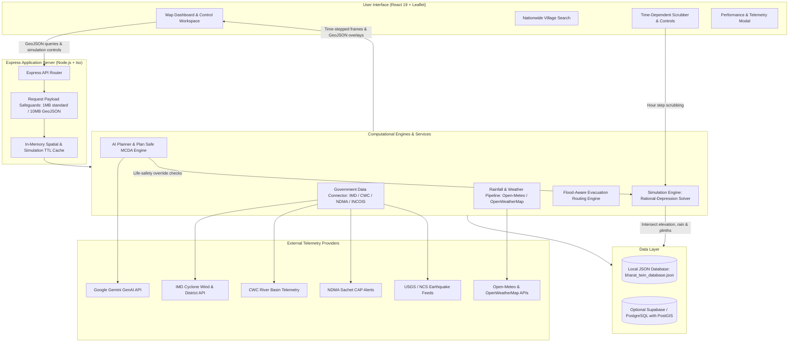

# Bharat Village Twin

> A nationwide, hyper-local geospatial digital twin and multi-hazard intelligence platform for Indian villages, empowering local gram panchayats, disaster managers, and rural communities with evidence-based hazard risk assessments, time-dependent flood simulations, and infrastructure screening.

[](https://nodejs.org/)
[](https://www.typescriptlang.org/)
[](https://react.dev/)
[](https://vitejs.dev/)
[](https://tailwindcss.com/)
[](https://expressjs.com/)
[](https://leafletjs.com/)
[](https://postgis.net/)

---

## Table of Contents

- [1. Overview](#1-overview)
- [2. Problem Statement & Motivation](#2-problem-statement--motivation)
- [3. Key Features](#3-key-features)
  - [Implemented Features](#implemented-features)
  - [Planned & Experimental Features](#planned--experimental-features)
- [4. How the System Works](#4-how-the-system-works)
- [5. Architecture Overview](#5-architecture-overview)
- [6. Technology Stack](#6-technology-stack)
- [7. Project Directory Structure](#7-project-directory-structure)
- [8. Prerequisites](#8-prerequisites)
- [9. Local Installation & Startup](#9-local-installation--startup)
- [10. Environment Variable Setup](#10-environment-variable-setup)
- [11. Database Configuration & Migrations](#11-database-configuration--migrations)
- [12. Testing, Linting & Production Build](#12-testing-linting--production-build)
- [13. Data Sources & Scientific Limitations](#13-data-sources--scientific-limitations)
- [14. Current Limitations & Roadmap](#14-current-limitations--roadmap)
- [15. Contribution Workflow & License](#15-contribution-workflow--license)

---

## 1. Overview

**Bharat Village Twin** is a nationwide, multi-hazard digital twin designed for rural India. While urban smart cities benefit from extensive sensor grids and stormwater modeling, rural gram panchayats often lack cadastral-level hazard intelligence, early warning context, and terrain-aware infrastructure screening.

Bharat Village Twin bridges this gap by combining:
- **Topographic & Hypsometric Modeling**: Evaluating depression ponding, soil infiltration, and plinth clearances from 30m digital elevation data.
- **Official Government Telemetry**: Integrating bulletins and telemetry from the Central Water Commission (CWC), India Meteorological Department (IMD), National Disaster Management Authority (NDMA Sachet), INCOIS, and USGS.
- **Dynamic Infrastructure & Road Exposure**: Spatially intersecting simulated hazards against open cadastral infrastructure, building footprints, and road corridors to identify impassable routes and vulnerable community structures.
- **Deterministic AI Planning & Fallbacks**: Delivering multi-criteria site suitability recommendations (refuges, evacuation paths, check dams) with hard life-safety overrides that reject flood-compromised locations.

---

## 2. Problem Statement & Motivation

Over 65% of India's population resides in rural villages, which endure recurring flood inundation, tropical cyclone landfalls, flash floods, seismic tremors, and droughts:
1. **The "Last-Mile" Granularity Gap**: National meteorological bulletins often provide district-level forecasts (e.g., "Heavy rain in Srikakulam"), which fail to tell a village sarpanch whether the primary access road or the local primary school will be submerged.
2. **Missing Cadastral Footprints**: Many Indian villages do not yet have complete OpenStreetMap building footprints or LIDAR plinth surveys. Digital twin platforms often either crash or fabricate dwellings when data is absent.
3. **Black-Box AI Hallucinations**: Generative AI tools often give dangerous advice, such as hallucinating that a road with 0.5m of water is "safe for two-wheelers" or recommending an emergency shelter inside a topographic depression.
4. **Bandwidth & Connectivity Realities**: Rural emergency operations centers require platforms that run resiliently with offline data fallbacks, fast tile rendering, and zero-configuration local modes.

Bharat Village Twin addresses these challenges through scientific ground truthing, clear separation between observations and model estimates, strict life-safety constraints, and transparent data disclosure.

---

## 3. Key Features

### Implemented Features

#### 🌊 Time-Dependent Flood Simulation
- **Topographic Rational-Depression Solver**: Simulates time-stepped ($t = 0\text{h}$ to $24\text{h}$) pluvial ponding and hypsometric accumulation based on design storms, soil infiltration curves (e.g., black cotton, alluvial clay, red loam), and drainage conveyance.
- **Temporal Progression & Controls**: Interactive timeline scrubber with play, pause, hour-by-hour stepping, and instant reset.
- **Hydrological Separation**: Strictly separates live observed rainfall ($\text{mm/h}$), completed-hour gauge readings ($\text{mm}$), near-term forecast accumulation, and simulated surface water depth ($\text{m}$).

#### 🛣️ 4-State Road Network Exposure
- **Spatial Line Intersection**: Uses ray-casting and segment intersection against flood polygons.
- **Clear Status Classification**:
  - `flooded` ($>0.25\text{m}$ water depth): Severed / impassable for vehicles, highlighted in high-contrast dashed red with dark underlay casing.
  - `affected` ($0\text{–}0.25\text{m}$ water depth): Waterlogged; passable only with caution for high-clearance emergency transport.
  - `unaffected`: Verified dry and passable under the scenario.
  - `unverified`: Road segment lacks elevation survey or falls outside the evaluated grid. Tooltips explicitly state: *"Do not assume safe merely because flood data is absent."*
- **Dedicated Evacuation Layer**: Vetted evacuation lifelines remain separate from the ordinary road network on dedicated map panes.

#### 🏢 Building Plinth & Structural Exposure
- **Plinth Ingress Analysis**: Spatially tests building footprints against local water depth and plinth heights (default $0.45\text{m}$ or cadastral attribute).
- **Ingress Classification**: Categorizes structures as `safe`, `low` (perimeter waterlogged), `moderate` (water reaches plinth), or `severe` (plinth overtopped).
- **Missing Data Honesty**: If building footprint layers are missing, the system reports `unavailable_unmapped` and notes that dwelling exposure cannot be evaluated, preventing false "0 buildings damaged" claims.

#### 🌦️ Real-Time Weather & Rainfall Diagnostics
- **Multi-Provider Weather Pipeline**: Integrates Open-Meteo, OpenWeatherMap, and WeatherAPI.
- **Accurate Rainfall Intensity**: Calculates average forecast intensity as total accumulated rain divided by actual interval hours, preventing premature rounding down to $0\text{ mm/h}$.
- **Attribution & Metadata**: Every reading identifies its source provider, timestamp, coordinate datum, and classification (`live_gauge`, `model_estimate`, `historical_reading`, or `forecast`).

#### 🌀 Cyclone Wind & Storm Tracking
- **Official IMD Bulletins**: Parses official India Meteorological Department RSMC bulletins and asymmetric quadrant wind radii ($34\text{ kt}$, $50\text{ kt}$, $64\text{ kt}$).
- **Observed vs. Forecast Distinction**: Visualizes past observed cyclone tracks as solid paths and future forecasted trajectories with dashed lines and cones of uncertainty.
- **Demonstration Scenarios**: Includes vetted demonstration scenarios (e.g., Bay of Bengal coastal strikes) for preparedness drills when no active cyclone is present.

#### 🏛️ Multi-Source Government Data Integration
- **Central Water Commission (CWC)**: Real-time river gauge levels, historical telemetry, and Warning/Danger level thresholds (e.g., Gotta Barrage on the Vamsadhara river).
- **NDMA Sachet Portal**: Ingests Common Alerting Protocol (CAP) disaster alerts across 755 districts.
- **INCOIS & USGS/NCS**: Live Indian Ocean tsunami bulletins and regional seismic activity monitoring.

#### 🧠 Grounded AI Planner & Plan Safe Screening
- **Multi-Objective Spatial Screening**: Evaluates candidate locations for flood shelters, evacuation corridors, drainage outfalls, and health facilities.
- **Deterministic Life-Safety Overrides**: Mathematical scoring is strictly overridden by safety constraints; candidate sites submerged under $>0.25\text{m}$ of simulated water are immediately marked `REJECTED`.
- **Hybrid AI Advisory**: Employs Google Gemini (`@google/genai`) for structured disaster recommendations, backed by deterministic rule-based fallback generators when offline.

#### 📊 Performance & Diagnostics Instrumentation
- **Real-Time Telemetry Ring Buffer**: Tracks API endpoint latencies, request sizes, and status codes.
- **Layer Duration Profiler**: Monitors render time and feature counts for all 15 map layers.
- **Cache Management**: Multi-provider cache hit ratio reporting and one-click cache flushing.

---

### Planned & Experimental Features

| Feature | Status | Description |
| :--- | :--- | :--- |
| **Full 2D Hydrodynamic Solver** | *Planned* | Upgrading from the current hypsometric depression solver to a full 2D Saint-Venant shallow water solver using WebAssembly/WebGL. |
| **Drone LiDAR Cadastral Importer** | *Experimental* | Tooling to import high-resolution cm-scale drone elevation surveys and cadastral vector maps (SVAMITVA scheme). |
| **Crowdsourced Hazard Verification** | *Planned* | Citizen reporting pipeline for local waterlogging, breach photos, and road blockages with geo-tag verification. |
| **SMS / IVR Alert Dispatcher** | *Experimental* | Automated local-language SMS alerts for gram panchayat leaders without smartphone internet access. |

---

## 4. How the System Works



1. **Location Selection & Coordinate Shift**: The user selects a village from the nationwide administrative hierarchy. The system shifts the spatial coordinate datum, elevation profile, and cadastral assets to the selected village center.
2. **Telemetry Ingestion**: The backend polls live or cached bulletins from IMD, CWC, NDMA, and Open-Meteo. Observations are tagged and stored with exact timestamps and provider metadata.
3. **Simulation Execution**: When a storm scenario is triggered (using live rain, forecast peaks, or design storms), the simulation engine generates time-stepped frames, calculating ponding depths across local elevation depressions and drainage outfalls.
4. **Spatial Intersection**: Each frame's inundation polygons are spatially intersected with road networks and building footprints. Roads receive one of four verified status codes, and buildings are screened for plinth overtopping.
5. **Map Rendering & Diagnostics**: Leaflet layers render the water depth palette, road alert casings, and building polygons. The telemetry service records rendering durations and feature counts for performance profiling.

---

## 5. Architecture Overview

### Layer Separation
- **Presentation Layer**: Built with React 19, Tailwind CSS v4, Lucide icons, and Leaflet. Custom map panes (`floodOverlayPane`, `roadsPane`, `buildingsPane`, `evacRoutePane`) guarantee that roads, routes, and building outlines remain legible over satellite basemaps.
- **Application & API Layer**: Node.js and Express 4 server (`server.ts`) hosting REST endpoints, caching middleware, payload size limiters, and telemetry ring buffers.
- **Analysis & Hydrology Layer**: Standalone TypeScript services responsible for depression filling, hypsometric stage-storage calculations, Haversine/geodesic distance math, and multi-criteria site scoring.
- **Data & Storage Layer**: Dual-mode storage architecture featuring an automatic zero-config file database (`data/bharat_twin_database.json`) and an enterprise PostgreSQL/PostGIS connection pool.

---

## 6. Technology Stack

### Frontend
- **Framework**: React 19 (`react`, `react-dom`)
- **Build Tool**: Vite 8.3 (`@vitejs/plugin-react`)
- **Styling**: Tailwind CSS v4 (`@tailwindcss/vite`, `tailwindcss`, `autoprefixer`)
- **Map & Geospatial Visualization**: Leaflet 1.9 (`leaflet`, `@types/leaflet`), MapLibre GL 6.14 (`maplibre-gl`), React Google Maps (`@vis.gl/react-google-maps`)
- **Icons & UI Components**: Lucide React (`lucide-react`), Motion (`motion`), Recharts 3.10 (`recharts`)

### Backend & Core Runtime
- **Runtime**: Node.js (v18+, v20+, or v22+)
- **Server Framework**: Express 4.21 (`express`, `@types/express`)
- **TypeScript Runner**: TSX (`tsx`)
- **Environment Management**: Dotenv (`dotenv`)
- **AI Integration**: Google Gen AI SDK (`@google/genai`)

### Database & Spatial Persistence
- **Default Database**: Local JSON persistence engine (`data/bharat_twin_database.json`)
- **PostgreSQL / PostGIS**: PostgreSQL client (`pg`, `@types/pg`)
- **Cloud Database**: Supabase Client (`@supabase/supabase-js`)

### Testing & Verification
- **Test Runner**: Node.js Native Test Runner (`node:test`, `node:assert`) executed via `tsx`
- **Headless Browser Diagnostics**: Puppeteer Core (`puppeteer-core`)

---

## 7. Project Directory Structure

```text
village-flood-digital-twin/
├── data/                                 # Embedded database and benchmark datasets
│   ├── bharat_twin_database.json         # Local zero-configuration JSON database
│   └── cwc_rainfall_2026_2030.csv        # Benchmark river basin rainfall series
├── src/
│   ├── components/                       # Modular React UI components
│   │   ├── ai/                           # AI Planner and advisory modals
│   │   ├── alerts/                       # Notification center and CAP alert viewer
│   │   ├── cyclone/                      # Cyclone tracking panels and wind radii UI
│   │   ├── diagnostics/                  # Performance & Telemetry Diagnostics modal
│   │   ├── drainage/                     # Drainage planner and intervention modals
│   │   ├── evacuation/                   # Safe evacuation route modals and steps
│   │   ├── map/                          # VillageMap core component and Leaflet layers
│   │   ├── search/                       # Nationwide location and pincode search
│   │   ├── simulation/                   # Hazard simulation cards and timeline controls
│   │   └── weather/                      # Real-time rainfall and weather panels
│   ├── data/                             # Geospatial reference and benchmark data
│   │   ├── benchmarkRoads.ts             # Benchmark cadastral road networks
│   │   ├── demoVillage.ts                # Synthetic baseline village dataset
│   │   ├── indiaAdministrativeHierarchy.ts # State, District, Sub-district hierarchy
│   │   ├── indiaLocations.ts             # Benchmark locations across Indian hazard zones
│   │   └── nationalRoadways.ts           # National and state highway vectors
│   ├── db/                               # Database client, schemas, and migrations
│   │   ├── client.ts                     # Database connection pool and status checks
│   │   ├── schema.ts                     # TypeScript database table definitions
│   │   └── migrations/                   # PostGIS SQL migrations and RLS policies
│   ├── services/                         # Core computational and integration services
│   │   ├── aiPlannerService.ts           # Multi-criteria planning and constraint checks
│   │   ├── alertWorker.ts                # Background alert processing service
│   │   ├── databaseService.ts            # Unified JSON / PostGIS persistence layer
│   │   ├── floodDataService.ts           # Hydrological calculation helpers
│   │   ├── governmentDataConnector.ts    # Direct IMD, CWC, NDMA, INCOIS connectors
│   │   ├── imdCycloneWindService.ts      # Cyclone wind radii processing
│   │   ├── performanceTracker.ts         # Latency, cache, and layer telemetry recorder
│   │   ├── rainfallDataService.ts        # Open-Meteo hourly parser and intensity math
│   │   └── simulationService.ts          # 2D rational-depression flood simulation engine
│   ├── types/                            # Authoritative TypeScript interface definitions
│   │   ├── flood.ts                      # Flood hydrology and gauge types
│   │   ├── hazard.ts                     # Multi-hazard risk assessment models
│   │   ├── nationwide.ts                 # Search and candidate site types
│   │   └── village.ts                    # Village dataset, roads, buildings, simulation frames
│   ├── App.tsx                           # Main application layout and state manager
│   ├── index.css                         # Global CSS and Tailwind directives
│   └── main.tsx                          # React DOM entry point
├── tests/                                # Comprehensive test suites (36 test files)
│   ├── aiPlannerAccuracyAudit.test.ts    # Tests for AI recommendations and life-safety overrides
│   ├── hazardValidation.test.ts          # Hazard score classification tests
│   ├── performanceDiagnostics.test.ts    # Telemetry and cache diagnostic tests
│   └── timeBasedFloodAndCycloneSimulation.test.ts # Time-stepped simulation tests
├── .env.example                          # Reference environment variable template
├── package.json                          # Dependencies, scripts, and project metadata
├── server.ts                             # Express backend application entry point
├── tsconfig.json                         # TypeScript compiler configuration
└── vite.config.ts                        # Vite configuration and plugin setup
```

---

## 8. Prerequisites

Ensure you have the following installed on your development machine:
- **Node.js**: `v18.0.0` or higher (`v20+` or `v22+` recommended). Verify with `node -v`.
- **npm**: `v9.0.0` or higher. Verify with `npm -v`.
- **Git**: For version control.

*(Optional)*:
- A free **Open-Meteo** account (no API key required for standard rate-limited tiers).
- A free **OpenWeatherMap** API key (for commercial weather comparison).
- A **Google Gemini API Key** (for GenAI natural-language advisory features).
- A **Supabase** account or local **PostgreSQL with PostGIS** (only needed if using external cloud database storage; local mode works out-of-the-box).

---

## 9. Local Installation & Startup

### Step 1: Clone the Repository
```bash
git clone https://github.com/pothanidedeephya/Villagetwin.git
cd Villagetwin
```

### Step 2: Install Dependencies
```bash
npm install
```

### Step 3: Configure Environment Variables
Copy the `.env.example` file to create `.env.local`:
```bash
cp .env.example .env.local
```
Edit `.env.local` with your preferred editor and provide the necessary keys (see [Section 10](#10-environment-variable-setup)).

### Step 4: Run the Development Server
```bash
npm run dev
```
The server will start on port `3000` (or the port specified by `PORT` in your environment). Open your browser and navigate to:
```text
http://localhost:3000
```

---

## 10. Environment Variable Setup

The backend loads environment variables with the following cascading priority:
`.env.local` $\rightarrow$ `.env.development.local` $\rightarrow$ `.env.development` $\rightarrow$ `.env`

Reference variables declared in `.env.example`:

| Variable Name | Required / Optional | Default / Description |
| :--- | :--- | :--- |
| `PORT` | Optional | Port for the Express server (defaults to `3000`). |
| `APP_URL` | Optional | Root URL for the application (e.g., `http://localhost:3000`). |
| `GEMINI_API_KEY` | Optional | Google Gemini API key for natural language advisory responses. |
| `OPENWEATHER_API_KEY` | Optional | OpenWeatherMap API key for live rainfall comparison. |
| `WEATHER_API_KEY` | Optional | Universal fallback key routed to OpenWeatherMap. |
| `WEATHERAPI_KEY` | Optional | WeatherAPI.com forecast key. |
| `VITE_GOOGLE_MAPS_API_KEY` | Optional | Google Maps vector basemap and imagery key. |
| `DATABASE_URL` | Optional | Direct PostgreSQL connection string with PostGIS support. |
| `PGHOST`, `PGPORT`, etc. | Optional | Discrete PostgreSQL connection credentials. |
| `SUPABASE_URL` | Optional | Supabase project REST endpoint. |
| `SUPABASE_SERVICE_ROLE_KEY` | Optional | Supabase service role key for administrative database bypass. |
| `SUPABASE_ANON_KEY` | Optional | Supabase anonymous client key. |
| `IMD_API_KEY` | Optional | Registered India Meteorological Department API key. |
| `IMD_BEARER_TOKEN` | Optional | Registered IMD JWT bearer token. |
| `TOMTOM_API_KEY` | Optional | Commercial traffic telemetry key for evacuation corridors. |

> [!NOTE]
> The application functions completely in local mode without any paid API keys. Open-Meteo forecasts, USGS earthquake feeds, CWC river telemetry, and the local JSON database operate with zero configuration out-of-the-box.

---

## 11. Database Configuration & Migrations

### Local JSON Mode (Default)
When no PostgreSQL or Supabase credentials are provided in `.env.local`, Bharat Village Twin automatically operates using the local file database at:
```text
data/bharat_twin_database.json
```
This stores locations, historical disaster events, risk assessments, user preferences, simulation runs, and alerts directly on disk without requiring any external database process.

### Enterprise PostGIS / Supabase Mode (Optional)
To use a production PostgreSQL database with spatial indexing:
1. Provision a PostgreSQL instance with the **PostGIS** extension enabled (e.g., Supabase, Neon, AWS RDS, or local Postgres).
2. Set `DATABASE_URL` or `SUPABASE_URL` in `.env.local`.
3. Apply the SQL migrations located in `src/db/migrations/` in sequence:
   - `0001_initial_schema.sql`: Core tables, enums, triggers, and indices.
   - `0002_preflight_check.sql`: Preflight role and schema verification.
   - `0002_supabase_postgis_rls.sql`: PostGIS geometric types, RLS policies, and spatial indices.
   - `0002_verify_schema.sql`: Verification queries confirming table integrity.

---

## 12. Testing, Linting & Production Build

### Running Tests
The project features an extensive automated test suite covering hazard boundary calculations, time-stepped flood models, road classification, cyclone tracks, AI life-safety overrides, and telemetry.

Run the complete test suite:
```bash
npm test
```

Run specialized UI and popup tests:
```bash
npm run test:ui
npm run test:duplicate-check
```

### TypeScript Type Checking & Linting
Verify TypeScript integrity across the codebase:
```bash
npm run lint
```
*(Runs `tsc --noEmit` without emitting JavaScript files).*

### Building for Production
Compile the client application with Vite:
```bash
npm run build
```
Compiled production assets are output to the `dist/` directory.

### Previewing Production Build
Preview the compiled production bundle:
```bash
npm run preview
```

### Cleaning Build Artifacts
```bash
npm run clean
```

---

## 13. Data Sources & Scientific Limitations

To prevent dangerous misinformation during disasters, Bharat Village Twin enforces strict provenance disclosure:

| Data Type | Examples in Platform | Status & Disclaimer |
| :--- | :--- | :--- |
| **Direct Observations** | CWC river gauges, USGS seismic coordinates, IMD rain gauges | **Verified Real-World Telemetry**: Reflects measured physical telemetry at a specific sensor station and timestamp. |
| **Official Forecasts** | IMD cyclone tracks, Open-Meteo 7-day hourly forecasts | **Probabilistic Model Predictions**: Official projections subject to atmospheric shifts and ensemble uncertainty. |
| **Modelled Simulations** | 2D Rational-Depression flood polygons, wind radii | **Screening Model Estimates**: Calculated from 30m digital elevation hypsometry, runoff coefficients, and infiltration. Not statutory warnings or certified ground truth. |
| **Demonstration Scenarios** | Synthetic cyclone landfall scenarios, mock drills | **Illustrative Preparedness Scenarios**: Clearly marked as mock scenarios for training, planning, and evaluation. |

---

## 14. Current Limitations & Roadmap

### Current Limitations
1. **DEM Spatial Resolution**: Elevation calculations currently use 30m satellite DEM data (SRTM / Copernicus). Micro-topography such as roadside curbs, local ditches, and small masonry bunds may not be fully resolved.
2. **Plinth Height Approximations**: Where cadastral field surveys are missing, building plinths default to $0.45\text{m}$ (per national building codes). Actual field plinths may vary.
3. **Pluvial vs. Fluvial Dynamics**: The simulation model primarily solves pluvial (rainfall ponding) accumulation. Dynamic river breach propagation requires official CWC telemetry monitoring.

### Roadmap
- [ ] Integration of 1m to 5m drone elevation data under the Survey of India SVAMITVA program.
- [ ] Direct WebAssembly-accelerated shallow water equation solver for GPU execution in the browser.
- [ ] Multilingual voice and audio advisory generation for regional Indian languages (Hindi, Telugu, Odia, Bengali, Tamil, Kannada, Marathi).
- [ ] Offline Progressive Web App (PWA) caching for field workers during telecom power outages.

---

## 15. Contribution Workflow & License

### Contribution Workflow
1. Fork the repository on GitHub.
2. Create a feature branch:
   ```bash
   git checkout -b feature/your-feature-name
   ```
3. Ensure all tests and type checks pass:
   ```bash
   npm run lint
   npm test
   npm run build
   ```
4. Commit your changes with clear, descriptive commit messages.
5. Push to your feature branch and open a Pull Request.

### License
This repository is currently maintained for research, academic evaluation, disaster resilience engineering, and hackathon demonstration. Refer to the repository maintainer for specific licensing, terms of use, and distribution rights.

---

<div align="center">
  <strong>Bharat Village Twin</strong> — Empowering Indian Gram Panchayats with Hyper-Local Disaster Intelligence.
</div>

**Bharat Village Twin** is a nationwide, multi-hazard digital twin designed for rural India. While urban smart cities benefit from extensive sensor grids and stormwater modeling, rural gram panchayats often lack cadastral-level hazard intelligence, early warning context, and terrain-aware infrastructure screening.

Bharat Village Twin bridges this gap by combining:
- **Topographic & Hypsometric Modeling**: Evaluating depression ponding, soil infiltration, and plinth clearances from 30m digital elevation data.
- **Official Government Telemetry**: Integrating bulletins and telemetry from the Central Water Commission (CWC), India Meteorological Department (IMD), National Disaster Management Authority (NDMA Sachet), INCOIS, and USGS.
- **Dynamic Infrastructure & Road Exposure**: Spatially intersecting simulated hazards against open cadastral infrastructure, building footprints, and road corridors to identify impassable routes and vulnerable community structures.
- **Deterministic AI Planning & Fallbacks**: Delivering multi-criteria site suitability recommendations (refuges, evacuation paths, check dams) with hard life-safety overrides that reject flood-compromised locations.

---

## 2. Problem Statement & Motivation

Over 65% of India's population resides in rural villages, which endure recurring flood inundation, tropical cyclone landfalls, flash floods, seismic tremors, and droughts:
1. **The "Last-Mile" Granularity Gap**: National meteorological bulletins often provide district-level forecasts (e.g., "Heavy rain in Srikakulam"), which fail to tell a village sarpanch whether the primary access road or the local primary school will be submerged.
2. **Missing Cadastral Footprints**: Many Indian villages do not yet have complete OpenStreetMap building footprints or LIDAR plinth surveys. Digital twin platforms often either crash or fabricate dwellings when data is absent.
3. **Black-Box AI Hallucinations**: Generative AI tools often give dangerous advice, such as hallucinating that a road with 0.5m of water is "safe for two-wheelers" or recommending an emergency shelter inside a topographic depression.
4. **Bandwidth & Connectivity Realities**: Rural emergency operations centers require platforms that run resiliently with offline data fallbacks, fast tile rendering, and zero-configuration local modes.

Bharat Village Twin addresses these challenges through scientific ground truthing, clear separation between observations and model estimates, strict life-safety constraints, and transparent data disclosure.

---

## 3. Key Features

### Implemented Features

#### 🌊 Time-Dependent Flood Simulation
- **Topographic Rational-Depression Solver**: Simulates time-stepped ($t = 0\text{h}$ to $24\text{h}$) pluvial ponding and hypsometric accumulation based on design storms, soil infiltration curves (e.g., black cotton, alluvial clay, red loam), and drainage conveyance.
- **Temporal Progression & Controls**: Interactive timeline scrubber with play, pause, hour-by-hour stepping, and instant reset.
- **Hydrological Separation**: Strictly separates live observed rainfall ($\text{mm/h}$), completed-hour gauge readings ($\text{mm}$), near-term forecast accumulation, and simulated surface water depth ($\text{m}$).

#### 🛣️ 4-State Road Network Exposure
- **Spatial Line Intersection**: Uses ray-casting and segment intersection against flood polygons.
- **Clear Status Classification**:
  - `flooded` ($>0.25\text{m}$ water depth): Severed / impassable for vehicles, highlighted in high-contrast dashed red with dark underlay casing.
  - `affected` ($0\text{–}0.25\text{m}$ water depth): Waterlogged; passable only with caution for high-clearance emergency transport.
  - `unaffected`: Verified dry and passable under the scenario.
  - `unverified`: Road segment lacks elevation survey or falls outside the evaluated grid. Tooltips explicitly state: *"Do not assume safe merely because flood data is absent."*
- **Dedicated Evacuation Layer**: Vetted evacuation lifelines remain separate from the ordinary road network on dedicated map panes.

#### 🏢 Building Plinth & Structural Exposure
- **Plinth Ingress Analysis**: Spatially tests building footprints against local water depth and plinth heights (default $0.45\text{m}$ or cadastral attribute).
- **Ingress Classification**: Categorizes structures as `safe`, `low` (perimeter waterlogged), `moderate` (water reaches plinth), or `severe` (plinth overtopped).
- **Missing Data Honesty**: If building footprint layers are missing, the system reports `unavailable_unmapped` and notes that dwelling exposure cannot be evaluated, preventing false "0 buildings damaged" claims.

#### 🌦️ Real-Time Weather & Rainfall Diagnostics
- **Multi-Provider Weather Pipeline**: Integrates Open-Meteo, OpenWeatherMap, and WeatherAPI.
- **Accurate Rainfall Intensity**: Calculates average forecast intensity as total accumulated rain divided by actual interval hours, preventing premature rounding down to $0\text{ mm/h}$.
- **Attribution & Metadata**: Every reading identifies its source provider, timestamp, coordinate datum, and classification (`live_gauge`, `model_estimate`, `historical_reading`, or `forecast`).

#### 🌀 Cyclone Wind & Storm Tracking
- **Official IMD Bulletins**: Parses official India Meteorological Department RSMC bulletins and asymmetric quadrant wind radii ($34\text{ kt}$, $50\text{ kt}$, $64\text{ kt}$).
- **Observed vs. Forecast Distinction**: Visualizes past observed cyclone tracks as solid paths and future forecasted trajectories with dashed lines and cones of uncertainty.
- **Demonstration Scenarios**: Includes vetted demonstration scenarios (e.g., Bay of Bengal coastal strikes) for preparedness drills when no active cyclone is present.

#### 🏛️ Multi-Source Government Data Integration
- **Central Water Commission (CWC)**: Real-time river gauge levels, historical telemetry, and Warning/Danger level thresholds (e.g., Gotta Barrage on the Vamsadhara river).
- **NDMA Sachet Portal**: Ingests Common Alerting Protocol (CAP) disaster alerts across 755 districts.
- **INCOIS & USGS/NCS**: Live Indian Ocean tsunami bulletins and regional seismic activity monitoring.

#### 🧠 Grounded AI Planner & Plan Safe Screening
- **Multi-Objective Spatial Screening**: Evaluates candidate locations for flood shelters, evacuation corridors, drainage outfalls, and health facilities.
- **Deterministic Life-Safety Overrides**: Mathematical scoring is strictly overridden by safety constraints; candidate sites submerged under $>0.25\text{m}$ of simulated water are immediately marked `REJECTED`.
- **Hybrid AI Advisory**: Employs Google Gemini (`@google/genai`) for structured disaster recommendations, backed by deterministic rule-based fallback generators when offline.

#### 📊 Performance & Diagnostics Instrumentation
- **Real-Time Telemetry Ring Buffer**: Tracks API endpoint latencies, request sizes, and status codes.
- **Layer Duration Profiler**: Monitors render time and feature counts for all 15 map layers.
- **Cache Management**: Multi-provider cache hit ratio reporting and one-click cache flushing.

---

### Planned & Experimental Features

| Feature | Status | Description |
| :--- | :--- | :--- |
| **Full 2D Hydrodynamic Solver** | *Planned* | Upgrading from the current hypsometric depression solver to a full 2D Saint-Venant shallow water solver using WebAssembly/WebGL. |
| **Drone LiDAR Cadastral Importer** | *Experimental* | Tooling to import high-resolution cm-scale drone elevation surveys and cadastral vector maps (SVAMITVA scheme). |
| **Crowdsourced Hazard Verification** | *Planned* | Citizen reporting pipeline for local waterlogging, breach photos, and road blockages with geo-tag verification. |
| **SMS / IVR Alert Dispatcher** | *Experimental* | Automated local-language SMS alerts for gram panchayat leaders without smartphone internet access. |

---

## 4. How the System Works


1. **Location Selection & Coordinate Shift**: The user selects a village from the nationwide administrative hierarchy. The system shifts the spatial coordinate datum, elevation profile, and cadastral assets to the selected village center.
2. **Telemetry Ingestion**: The backend polls live or cached bulletins from IMD, CWC, NDMA, and Open-Meteo. Observations are tagged and stored with exact timestamps and provider metadata.
3. **Simulation Execution**: When a storm scenario is triggered (using live rain, forecast peaks, or design storms), the simulation engine generates time-stepped frames, calculating ponding depths across local elevation depressions and drainage outfalls.
4. **Spatial Intersection**: Each frame's inundation polygons are spatially intersected with road networks and building footprints. Roads receive one of four verified status codes, and buildings are screened for plinth overtopping.
5. **Map Rendering & Diagnostics**: Leaflet layers render the water depth palette, road alert casings, and building polygons. The telemetry service records rendering durations and feature counts for performance profiling.

---

## 5. Architecture Overview

### Layer Separation
- **Presentation Layer**: Built with React 19, Tailwind CSS v4, Lucide icons, and Leaflet. Custom map panes (`floodOverlayPane`, `roadsPane`, `buildingsPane`, `evacRoutePane`) guarantee that roads, routes, and building outlines remain legible over satellite basemaps.
- **Application & API Layer**: Node.js and Express 4 server (`server.ts`) hosting REST endpoints, caching middleware, payload size limiters, and telemetry ring buffers.
- **Analysis & Hydrology Layer**: Standalone TypeScript services responsible for depression filling, hypsometric stage-storage calculations, Haversine/geodesic distance math, and multi-criteria site scoring.
- **Data & Storage Layer**: Dual-mode storage architecture featuring an automatic zero-config file database (`data/bharat_twin_database.json`) and an enterprise PostgreSQL/PostGIS connection pool.

---

## 6. Technology Stack

### Frontend
- **Framework**: React 19 (`react`, `react-dom`)
- **Build Tool**: Vite 8.3 (`@vitejs/plugin-react`)
- **Styling**: Tailwind CSS v4 (`@tailwindcss/vite`, `tailwindcss`, `autoprefixer`)
- **Map & Geospatial Visualization**: Leaflet 1.9 (`leaflet`, `@types/leaflet`), MapLibre GL 6.14 (`maplibre-gl`), React Google Maps (`@vis.gl/react-google-maps`)
- **Icons & UI Components**: Lucide React (`lucide-react`), Motion (`motion`), Recharts 3.10 (`recharts`)

### Backend & Core Runtime
- **Runtime**: Node.js (v18+, v20+, or v22+)
- **Server Framework**: Express 4.21 (`express`, `@types/express`)
- **TypeScript Runner**: TSX (`tsx`)
- **Environment Management**: Dotenv (`dotenv`)
- **AI Integration**: Google Gen AI SDK (`@google/genai`)

### Database & Spatial Persistence
- **Default Database**: Local JSON persistence engine (`data/bharat_twin_database.json`)
- **PostgreSQL / PostGIS**: PostgreSQL client (`pg`, `@types/pg`)
- **Cloud Database**: Supabase Client (`@supabase/supabase-js`)

### Testing & Verification
- **Test Runner**: Node.js Native Test Runner (`node:test`, `node:assert`) executed via `tsx`
- **Headless Browser Diagnostics**: Puppeteer Core (`puppeteer-core`)

---

## 7. Project Directory Structure

```text
village-flood-digital-twin/
├── data/                                 # Embedded database and benchmark datasets
│   ├── bharat_twin_database.json         # Local zero-configuration JSON database
│   └── cwc_rainfall_2026_2030.csv        # Benchmark river basin rainfall series
├── src/
│   ├── components/                       # Modular React UI components
│   │   ├── ai/                           # AI Planner and advisory modals
│   │   ├── alerts/                       # Notification center and CAP alert viewer
│   │   ├── cyclone/                      # Cyclone tracking panels and wind radii UI
│   │   ├── diagnostics/                  # Performance & Telemetry Diagnostics modal
│   │   ├── drainage/                     # Drainage planner and intervention modals
│   │   ├── evacuation/                   # Safe evacuation route modals and steps
│   │   ├── map/                          # VillageMap core component and Leaflet layers
│   │   ├── search/                       # Nationwide location and pincode search
│   │   ├── simulation/                   # Hazard simulation cards and timeline controls
│   │   └── weather/                      # Real-time rainfall and weather panels
│   ├── data/                             # Geospatial reference and benchmark data
│   │   ├── benchmarkRoads.ts             # Benchmark cadastral road networks
│   │   ├── demoVillage.ts                # Synthetic baseline village dataset
│   │   ├── indiaAdministrativeHierarchy.ts # State, District, Sub-district hierarchy
│   │   ├── indiaLocations.ts             # Benchmark locations across Indian hazard zones
│   │   └── nationalRoadways.ts           # National and state highway vectors
│   ├── db/                               # Database client, schemas, and migrations
│   │   ├── client.ts                     # Database connection pool and status checks
│   │   ├── schema.ts                     # TypeScript database table definitions
│   │   └── migrations/                   # PostGIS SQL migrations and RLS policies
│   ├── services/                         # Core computational and integration services
│   │   ├── aiPlannerService.ts           # Multi-criteria planning and constraint checks
│   │   ├── alertWorker.ts                # Background alert processing service
│   │   ├── databaseService.ts            # Unified JSON / PostGIS persistence layer
│   │   ├── floodDataService.ts           # Hydrological calculation helpers
│   │   ├── governmentDataConnector.ts    # Direct IMD, CWC, NDMA, INCOIS connectors
│   │   ├── imdCycloneWindService.ts      # Cyclone wind radii processing
│   │   ├── performanceTracker.ts         # Latency, cache, and layer telemetry recorder
│   │   ├── rainfallDataService.ts        # Open-Meteo hourly parser and intensity math
│   │   └── simulationService.ts          # 2D rational-depression flood simulation engine
│   ├── types/                            # Authoritative TypeScript interface definitions
│   │   ├── flood.ts                      # Flood hydrology and gauge types
│   │   ├── hazard.ts                     # Multi-hazard risk assessment models
│   │   ├── nationwide.ts                 # Search and candidate site types
│   │   └── village.ts                    # Village dataset, roads, buildings, simulation frames
│   ├── App.tsx                           # Main application layout and state manager
│   ├── index.css                         # Global CSS and Tailwind directives
│   └── main.tsx                          # React DOM entry point
├── tests/                                # Comprehensive test suites (36 test files)
│   ├── aiPlannerAccuracyAudit.test.ts    # Tests for AI recommendations and life-safety overrides
│   ├── hazardValidation.test.ts          # Hazard score classification tests
│   ├── performanceDiagnostics.test.ts    # Telemetry and cache diagnostic tests
│   └── timeBasedFloodAndCycloneSimulation.test.ts # Time-stepped simulation tests
├── .env.example                          # Reference environment variable template
├── package.json                          # Dependencies, scripts, and project metadata
├── server.ts                             # Express backend application entry point
├── tsconfig.json                         # TypeScript compiler configuration
└── vite.config.ts                        # Vite configuration and plugin setup
```

---

## 8. Prerequisites

Ensure you have the following installed on your development machine:
- **Node.js**: `v18.0.0` or higher (`v20+` or `v22+` recommended). Verify with `node -v`.
- **npm**: `v9.0.0` or higher. Verify with `npm -v`.
- **Git**: For version control.

*(Optional)*:
- A free **Open-Meteo** account (no API key required for standard rate-limited tiers).
- A free **OpenWeatherMap** API key (for commercial weather comparison).
- A **Google Gemini API Key** (for GenAI natural-language advisory features).
- A **Supabase** account or local **PostgreSQL with PostGIS** (only needed if using external cloud database storage; local mode works out-of-the-box).

---

## 9. Local Installation & Startup

### Step 1: Clone the Repository
```bash
git clone https://github.com/pothanidedeephya/Villagetwin.git
cd Villagetwin
```

### Step 2: Install Dependencies
```bash
npm install
```

### Step 3: Configure Environment Variables
Copy the `.env.example` file to create `.env.local`:
```bash
cp .env.example .env.local
```
Edit `.env.local` with your preferred editor and provide the necessary keys (see [Section 10](#10-environment-variable-setup)).

### Step 4: Run the Development Server
```bash
npm run dev
```
The server will start on port `3000` (or the port specified by `PORT` in your environment). Open your browser and navigate to:
```text
http://localhost:3000
```

---

## 10. Environment Variable Setup

The backend loads environment variables with the following cascading priority:
`.env.local` $\rightarrow$ `.env.development.local` $\rightarrow$ `.env.development` $\rightarrow$ `.env`

Reference variables declared in `.env.example`:

| Variable Name | Required / Optional | Default / Description |
| :--- | :--- | :--- |
| `PORT` | Optional | Port for the Express server (defaults to `3000`). |
| `APP_URL` | Optional | Root URL for the application (e.g., `http://localhost:3000`). |
| `GEMINI_API_KEY` | Optional | Google Gemini API key for natural language advisory responses. |
| `OPENWEATHER_API_KEY` | Optional | OpenWeatherMap API key for live rainfall comparison. |
| `WEATHER_API_KEY` | Optional | Universal fallback key routed to OpenWeatherMap. |
| `WEATHERAPI_KEY` | Optional | WeatherAPI.com forecast key. |
| `VITE_GOOGLE_MAPS_API_KEY` | Optional | Google Maps vector basemap and imagery key. |
| `DATABASE_URL` | Optional | Direct PostgreSQL connection string with PostGIS support. |
| `PGHOST`, `PGPORT`, etc. | Optional | Discrete PostgreSQL connection credentials. |
| `SUPABASE_URL` | Optional | Supabase project REST endpoint. |
| `SUPABASE_SERVICE_ROLE_KEY` | Optional | Supabase service role key for administrative database bypass. |
| `SUPABASE_ANON_KEY` | Optional | Supabase anonymous client key. |
| `IMD_API_KEY` | Optional | Registered India Meteorological Department API key. |
| `IMD_BEARER_TOKEN` | Optional | Registered IMD JWT bearer token. |
| `TOMTOM_API_KEY` | Optional | Commercial traffic telemetry key for evacuation corridors. |

> [!NOTE]
> The application functions completely in local mode without any paid API keys. Open-Meteo forecasts, USGS earthquake feeds, CWC river telemetry, and the local JSON database operate with zero configuration out-of-the-box.

---

## 11. Database Configuration & Migrations

### Local JSON Mode (Default)
When no PostgreSQL or Supabase credentials are provided in `.env.local`, Bharat Village Twin automatically operates using the local file database at:
```text
data/bharat_twin_database.json
```
This stores locations, historical disaster events, risk assessments, user preferences, simulation runs, and alerts directly on disk without requiring any external database process.

### Enterprise PostGIS / Supabase Mode (Optional)
To use a production PostgreSQL database with spatial indexing:
1. Provision a PostgreSQL instance with the **PostGIS** extension enabled (e.g., Supabase, Neon, AWS RDS, or local Postgres).
2. Set `DATABASE_URL` or `SUPABASE_URL` in `.env.local`.
3. Apply the SQL migrations located in `src/db/migrations/` in sequence:
   - `0001_initial_schema.sql`: Core tables, enums, triggers, and indices.
   - `0002_preflight_check.sql`: Preflight role and schema verification.
   - `0002_supabase_postgis_rls.sql`: PostGIS geometric types, RLS policies, and spatial indices.
   - `0002_verify_schema.sql`: Verification queries confirming table integrity.

---

## 12. Testing, Linting & Production Build

### Running Tests
The project features an extensive automated test suite covering hazard boundary calculations, time-stepped flood models, road classification, cyclone tracks, AI life-safety overrides, and telemetry.

Run the complete test suite:
```bash
npm test
```

Run specialized UI and popup tests:
```bash
npm run test:ui
npm run test:duplicate-check
```

### TypeScript Type Checking & Linting
Verify TypeScript integrity across the codebase:
```bash
npm run lint
```
*(Runs `tsc --noEmit` without emitting JavaScript files).*

### Building for Production
Compile the client application with Vite:
```bash
npm run build
```
Compiled production assets are output to the `dist/` directory.

### Previewing Production Build
Preview the compiled production bundle:
```bash
npm run preview
```

### Cleaning Build Artifacts
```bash
npm run clean
```

---

## 13. Data Sources & Scientific Limitations

To prevent dangerous misinformation during disasters, Bharat Village Twin enforces strict provenance disclosure:

| Data Type | Examples in Platform | Status & Disclaimer |
| :--- | :--- | :--- |
| **Direct Observations** | CWC river gauges, USGS seismic coordinates, IMD rain gauges | **Verified Real-World Telemetry**: Reflects measured physical telemetry at a specific sensor station and timestamp. |
| **Official Forecasts** | IMD cyclone tracks, Open-Meteo 7-day hourly forecasts | **Probabilistic Model Predictions**: Official projections subject to atmospheric shifts and ensemble uncertainty. |
| **Modelled Simulations** | 2D Rational-Depression flood polygons, wind radii | **Screening Model Estimates**: Calculated from 30m digital elevation hypsometry, runoff coefficients, and infiltration. Not statutory warnings or certified ground truth. |
| **Demonstration Scenarios** | Synthetic cyclone landfall scenarios, mock drills | **Illustrative Preparedness Scenarios**: Clearly marked as mock scenarios for training, planning, and evaluation. |

---

## 14. Current Limitations & Roadmap

### Current Limitations
1. **DEM Spatial Resolution**: Elevation calculations currently use 30m satellite DEM data (SRTM / Copernicus). Micro-topography such as roadside curbs, local ditches, and small masonry bunds may not be fully resolved.
2. **Plinth Height Approximations**: Where cadastral field surveys are missing, building plinths default to $0.45\text{m}$ (per national building codes). Actual field plinths may vary.
3. **Pluvial vs. Fluvial Dynamics**: The simulation model primarily solves pluvial (rainfall ponding) accumulation. Dynamic river breach propagation requires official CWC telemetry monitoring.

### Roadmap
- [ ] Integration of 1m to 5m drone elevation data under the Survey of India SVAMITVA program.
- [ ] Direct WebAssembly-accelerated shallow water equation solver for GPU execution in the browser.
- [ ] Multilingual voice and audio advisory generation for regional Indian languages (Hindi, Telugu, Odia, Bengali, Tamil, Kannada, Marathi).
- [ ] Offline Progressive Web App (PWA) caching for field workers during telecom power outages.

---

## 15. Contribution Workflow & License

### Contribution Workflow
1. Fork the repository on GitHub.
2. Create a feature branch:
   ```bash
   git checkout -b feature/your-feature-name
   ```
3. Ensure all tests and type checks pass:
   ```bash
   npm run lint
   npm test
   npm run build
   ```
4. Commit your changes with clear, descriptive commit messages.
5. Push to your feature branch and open a Pull Request.

### License
This repository is currently maintained for research, academic evaluation, disaster resilience engineering, and hackathon demonstration. Refer to the repository maintainer for specific licensing, terms of use, and distribution rights.

---

<div align="center">
  <strong>Bharat Village Twin</strong> — Empowering Indian Gram Panchayats with Hyper-Local Disaster Intelligence.
</div>
